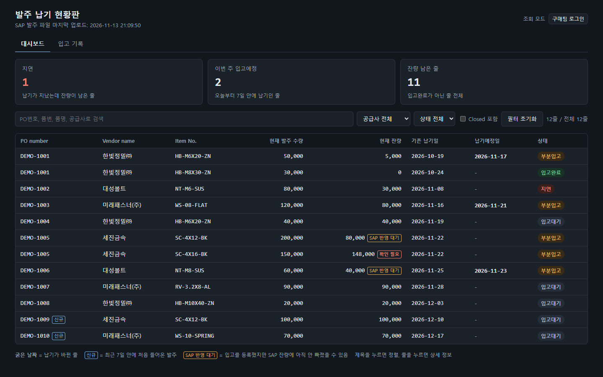
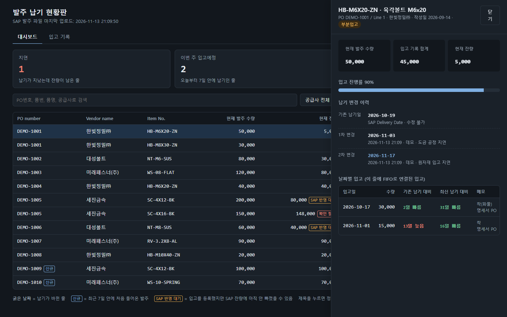
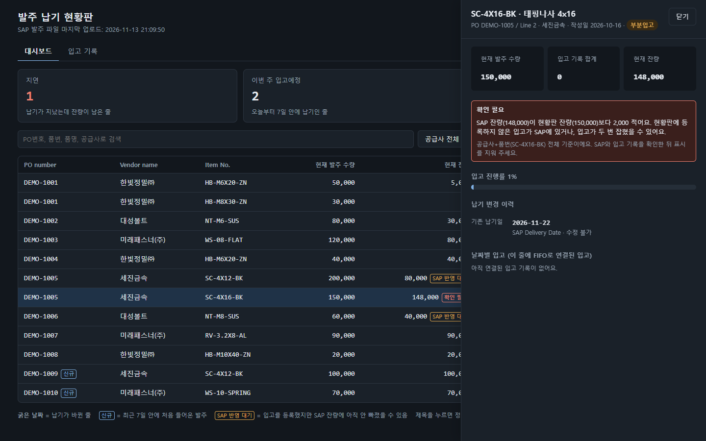
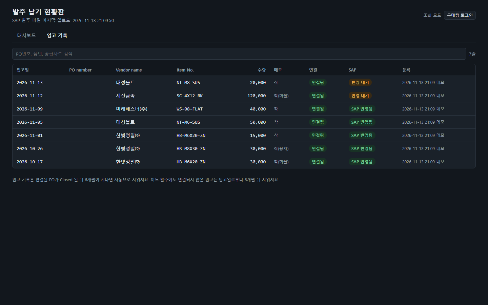

# 구매 발주 현황판

구매 실무에서 엑셀로 하던 **발주 잔량 확인·납기·입고 관리**를 좀 더 직관적이고 편리하게 할 수 있도록 웹상에 옮긴 프로젝트입니다.
구매 담당자가 직접 업무 문제를 정의하고 규칙을 설계했으며, AI 코딩 도구(Claude Code)와 함께 구현했습니다.



> 화면의 공급사·품번·PO 번호는 모두 예시용 가상 데이터

## 왜 만들었나

기존에는 SAP에서 내려받은 발주 목록과 거래명세서를 엑셀에 붙여넣고, 수식으로 잔량과 납기를 관리했습니다. 이 방식에는 다음 문제가 있었습니다.

| 문제 | 영향 |
|---|---|
| 발주서를 붙여넣을 때 중복 건이 발생하거나 수식 오류가 종종 발생 | 잔량에 오류가 생김 |
| raw data를 일일이 파일에 맞게 발라내야 함 | 업무 중 해당 파일 관리에 너무 많은 시간 소요 |
| 납기예정일을 PO+업체+품번+수량으로 찾아서, 납기가 다른 분할 줄에 같은 날짜가 들어감 | 분할 납품 관리가 안 됨 |
| 납기를 바꾸면 이전 값이 사라짐 | 공급사가 납기를 몇 번 미뤘는지 알 수 없음 |
| 파일이 한 사람 PC에 있음 | 다른 부서는 매번 물어봐야 함 |

→ 빠른 업무 적용을 위해 쓰던 엑셀의 흐름과 열 구성을 최대한 유지하되, 자동화가 필요한 부분 및 직관적이지 않은 부분만 고침

## 주요 기능

- **SAP 발주 목록 올리기:** 엑셀 파일 또는 텍스트 붙여넣기로 올립니다.
  - Indirect, Closed 처리된 행, 원화 외 통화 발주는 자동으로 삭제합니다.
  - PO number, Posting Date, Delivery Date, Item No., Vendor Name 5가지가 모두 같은 줄은 하나만 남깁니다. 값이 다르면 가장 최근 것을 남깁니다.
  - 목록에서 사라진 발주는 Closed로 기록합니다.
- **납기 변경 이력:** 처음 받은 납기일은 그대로 두고, 바뀐 납기예정일을 사유와 함께 모두 보관합니다.
- **거래명세서 입고 올리기**
  - 엑셀, PDF, **스캔 PDF** 모두 올릴 수 있습니다. 스캔 PDF는 Windows에 들어 있는 한국어 글자 인식 기능으로 읽습니다.
  - 업체마다 다른 양식에서 제목줄 위치를 찾아 품번, 수량, 입고일, 공급사를 읽습니다.
  - 글자 인식에서 헷갈리기 쉬운 글자(0/O, 1/I, 5/S 등)는 SAP 품번과 맞춰 고칩니다.
  - 읽은 결과는 사람이 확인하고 고친 뒤 저장합니다.
- **입고 즉시 반영 + FIFO:** 등록한 입고는 같은 공급사·품번 발주 중 **PO 작성일이 빠른 줄부터** 잔량에서 바로 뺍니다.
- **SAP 이중 반영 점검:** 새 SAP 목록을 올릴 때마다 현황판 잔량과 SAP 잔량을 공급사+품번별로 대조합니다.

  | 대조 결과 | 판단 |
  |---|---|
  | 일치 | SAP 반영 완료 |
  | 차이가 최근 2일 입고와 일치 | 아직 SAP 반영 전 |
  | 그 밖 | **확인 필요** (이중 입고, 미등록 입고 의심) |

- **권한:** 구매팀은 로그인해서 입력하고, 다른 부서는 로그인 없이 조회만 합니다.
- **자동 관리:** 매일 백업하고, Closed 된 지 6개월이 지난 기록은 자동으로 정리합니다.
- **단가 정보 제외:** 업로드할 때 단가·금액 열은 읽지도 저장하지도 않습니다.

## 화면

| 상세 화면: 납기 변경 이력과 날짜별 입고 | 잔량 대조: 확인 필요 |
|---|---|
|  |  |



## 핵심 규칙 (요약)

| 규칙 | 내용 |
|---|---|
| 같은 발주 줄 | PO number · Posting Date · Delivery Date · Item No. · Vendor Name이 모두 같음 |
| 현재 잔량 | SAP 잔량 − 아직 SAP에서 확인되지 않은 등록 입고 |
| FIFO | 같은 공급사+품번의 발주를 PO 작성일 → PO 번호 → PO Line 순으로 채움 |
| 지연 | 납기(바뀐 납기 포함)가 지났는데 잔량이 남음 |
| SAP 대조 | PO number + PO Line으로 새 발주를 빼고, 공급사+품번별로 잔량 비교. PO 수량이 바뀐 만큼은 정상으로 봄 |

자세한 내용은 [기획안](docs/기획안.md)과 [사용설명서](사용설명서.md)에 있습니다.

## 기술적인 특징

- **설치할 것이 Node.js 하나뿐:** 외부 패키지를 쓰지 않습니다. 회사 PC에 따로 프로그램을 설치하기 어려운 환경을 고려했습니다.
  - Node.js 내장 기능: `http` 서버, `node:sqlite` 데이터베이스, `zlib`
  - 엑셀(.xlsx) 파일은 zip을 직접 풀어서 읽습니다. ([lib/zip.js](lib/zip.js), [lib/xlsx.js](lib/xlsx.js))
- **PDF·스캔본 읽기:** Windows 내장 PDF 렌더링과 OCR(Windows.Data.Pdf, Windows.Media.Ocr)을 PowerShell로 호출합니다. ([lib/pdf-ocr.ps1](lib/pdf-ocr.ps1))
- **공유 규칙:** 업로드 가공 규칙은 [lib/rules.js](lib/rules.js) 하나에 있고, 브라우저(미리보기)와 서버(저장)가 같은 코드를 씁니다.
- **자동 검사:** `node --test`로 날짜 해석, 중복 규칙, FIFO, SAP 대조, 파일 읽기를 검사합니다.

## 실행해 보기

[Node.js](https://nodejs.org/) 24 이상이 필요합니다. PDF 읽기는 Windows에서만 동작합니다.

```bash
git clone <이 저장소 주소>
cd po-delivery-dashboard
npm run demo
```

브라우저에서 http://localhost:3100 을 열면 예시 데이터로 된 화면을 볼 수 있습니다.

- 실제로 쓸 때: `시작하기.bat`을 더블클릭하거나 `node server.js`를 실행합니다.
- 우리 회사 이름은 `data/buyer-names.txt`에 적어 둡니다. 거래명세서에서 공급사를 고를 때 이 이름을 뺍니다.

```bash
npm test
```

## 폴더 구조

```
server.js            웹 서버, 로그인, API
lib/rules.js         업로드 가공 규칙 (브라우저·서버 공용)
lib/store.js         데이터베이스, FIFO 배분, SAP 대조
lib/receipt-forms.js 업체별 거래명세서 양식 읽기
lib/files.js         엑셀·PDF 파일 처리
lib/xlsx.js, zip.js  엑셀 파일 읽기 (외부 패키지 없이)
lib/pdf-ocr.ps1      Windows PDF 렌더링 + 글자 인식
public/              화면 (HTML, CSS, JS)
test/                자동 검사
demo/make-demo.js    예시 데이터 만들기
docs/                기획안, 화면 캡처
```

## 만든 과정

1. **기존 엑셀 분석:** 시트 구성, 수식, 붙여넣기 방식을 분석해 문제를 정리했습니다.
2. **기획:** 업무 규칙을 정했습니다. 중복 기준, 납기 이력, FIFO, 자동 삭제 기준 등입니다.
3. **화면 미리보기:** 실제 데이터 없이 화면 모양부터 확인했습니다.
4. **개발과 실사용:** 실제 업무에 쓰면서 나온 요구를 반영했습니다.
   - 거래명세서 파일 업로드
   - 입고 즉시 반영
   - SAP 이중 반영 점검
